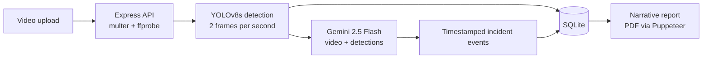

# Sentire

**An intelligent, general-purpose incident detection system for video footage.**

Sentire takes an uploaded video, finds people and weapons in it with YOLOv8, then hands the footage and detections to Google's Gemini vision-language model, which returns a timeline of what happened: each incident described in plain language with its start and end time (for example, a theft, the weapon involved and when it occurred). Results can be exported as a written PDF report.

Built as a graduation project at King Abdulaziz University. Every part of the system, backend, detection pipeline and frontend, was developed by [Hamzah Alsharief](https://www.linkedin.com/in/hamzah-alsharief).

## How it works



1. **Upload.** An authenticated user uploads a video. The API stores it, reads its duration with `ffprobe`, and starts the pipeline in the background so the request returns immediately.
2. **Detection.** `src/pipeline/detect.py` samples two frames per second and runs YOLOv8s, keeping only the classes the system cares about (person, knife, scissors) and flagging weapons as high priority. It writes the bounding boxes, an annotated copy of the video and a compact summary for the next stage.
3. **Interpretation.** `src/pipeline/vlm.py` sends the original video plus the detection summary to Gemini 2.5 Flash with a structured-output schema, so the model returns machine-readable events instead of free text.
4. **Storage.** Node validates the events and stores them in SQLite against the video.
5. **Reporting.** `src/pipeline/report.py` asks Gemini to write a professional incident narrative from the events and detection statistics, and the API renders it to PDF with Puppeteer.

## Features

- **Authentication:** registration and login with bcrypt-hashed passwords and JWTs that expire after one hour, enforced by middleware on every protected route.
- **Access control:** accounts carry a `user`, `admin` or `rootAdmin` role, and every video and report query is scoped to the logged-in user, so users only ever see their own data.
- **Account lifecycle:** soft deletion of accounts, with a nightly cron job that permanently removes accounts deleted more than a year ago.
- **Video processing:** upload, background detection and interpretation, and per-video incident timelines.
- **Reports:** narrative incident reports, viewable in the app or downloadable as PDF.

## Evaluation

The detection stage was evaluated on 2,125 detections across 12 processed videos, plus validation on COCO128 restricted to the three classes the system uses. Full results and plots are in [`kmeans_results/report.md`](kmeans_results/report.md).

| Class | Precision | Recall | mAP@0.5 |
|---|---|---|---|
| Person | 0.862 | 0.717 | 0.825 |
| Knife | 0.855 | 0.688 | 0.819 |

K-means clustering on the detected bounding boxes (elbow analysis, k = 4) reached an average IoU of 0.692 between boxes and their anchor centroids.

## Tech stack

| Layer | Tools |
|---|---|
| Backend | Node.js, Express 5, better-sqlite3, JWT, bcrypt, multer, cron |
| Detection | Python, Ultralytics YOLOv8, OpenCV, ffmpeg/ffprobe |
| Interpretation | Google Gemini 2.5 Flash (`google-genai`) |
| Reporting | Puppeteer (PDF rendering) |
| Frontend | Next.js, TypeScript, shadcn/ui |
| Evaluation | scikit-learn, NumPy, Matplotlib |

## API

| Method | Endpoint | Purpose |
|---|---|---|
| POST | `/api/auth/register` | Create an account |
| POST | `/api/auth/login` | Log in and receive a JWT |
| GET / PUT / DELETE | `/api/user/profile` | Read, update or delete your profile |
| POST | `/api/video/upload` | Upload a video and start the pipeline |
| GET | `/api/video` | List your videos |
| GET | `/api/video/:id` | Get a video with its detected events |
| POST / GET | `/api/video/:id/report` | Generate or fetch the incident report |
| GET | `/api/video/:id/report/pdf` | Download the report as PDF |
| GET | `/api/reports` | List your reports |

All routes except `/api/auth/*` require an `Authorization: Bearer <token>` header. `src/testingApiEndpoints.bash` exercises the endpoints with curl.

## Running it locally

Requirements: Node.js 20+, Python 3.10+, ffmpeg, and a [Gemini API key](https://aistudio.google.com/apikey).

```bash
git clone https://github.com/veliax/Sentire.git
cd Sentire
npm install

python3 -m venv venv
./venv/bin/pip install -r requirements.txt

cp .env.example .env
npm run dev
```

Fill in `JWT_SECRET` and `GEMINI_API_KEY` in `.env` before starting. The API runs on `http://localhost:5000` and accepts requests from the frontend on `http://localhost:3000`. YOLOv8 weights are downloaded automatically on the first run.

The development log for the project is in [`docs/devlog.md`](docs/devlog.md).
